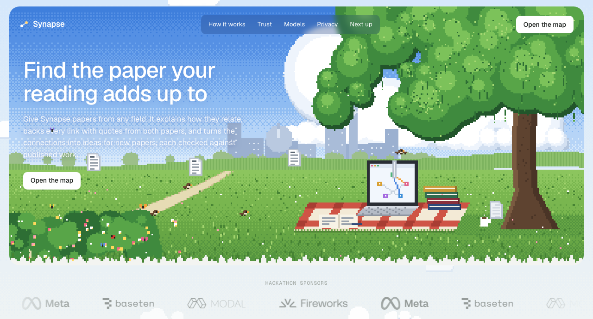
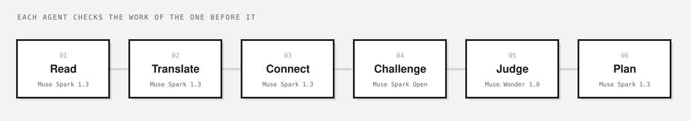

<p align="center">
  
</p>

<p align="center">
  <b>Synapse reads papers from any field, finds how they relate, and backs every link with quotes from both papers.</b><br>
  Then a second model tries to break each link, and what survives becomes a plan for a new paper.
</p>

<p align="center">
  <a href="#how-it-works">How it works</a> ·
  <a href="#why-you-can-trust-a-link">Trust</a> ·
  <a href="#models">Models</a> ·
  <a href="#privacy-and-safety">Privacy</a> ·
  <a href="#run-it-yourself">Run it</a>
</p>

> [!NOTE]
> Built by **Team Constellation** (Solo) at the Meta Global AI Developer Hackathon 2026 (Indie track). The sponsors provided API access during the hackathon, which has ended, so the online version no longer reads papers. To use Synapse, run it on your own computer with your own Meta API key.

<br>

<p align="center">
  
</p>

## The idea

A method that settled a question in one field is often the missing piece in another. Nobody reads every literature, so those links go unnoticed.

Synapse reads a set of papers the way a careful colleague would. It doesn't stop at saying two papers are "related": it shows **where in each paper** the link comes from, has a second model **argue against it**, and only keeps what holds up.

## How it works

<p align="center">
  
</p>

| | Step | What happens |
|---|---|---|
| 01 | **Read** | Every page of each paper is read. Its claims, methods and open questions are pulled out, each with a quote. |
| 02 | **Translate** | Each idea is rewritten in plain words, so papers from different fields can be compared without the jargon. |
| 03 | **Connect** | Pairs worth a closer look are shortlisted, and each link is explained with a quote from *both* papers. |
| 04 | **Challenge** | A different model asks five questions to break every link. Links that only share a word are thrown out. |
| 05 | **Judge** | The strongest link gets a final ruling: confirm, keep with a caveat, or reject. |
| 06 | **Plan** | What survives becomes a paper someone could write: the question, an outline, risks and a first step. On request, it checks top journals and conferences for whether it's been done. |

The app shows every agent at work: what it read, what it proposed, what the Challenger asked, and why each link was kept or dropped.

## Why you can trust a link

- **Quotes are checked by code, word for word.** If a quote isn't in the paper, it's dropped before anyone sees it.
- **Two models, not one.** The model that proposes a link is never the one that tests it.
- **Every source is screened first.** Before any agent reads a paper, a check looks for content that isn't research or that tries to give the AI orders. Hidden text on web pages is removed.
- **Only reputable sources.** Links must come from well-known publishers and preprint servers. Literature searches keep only flagship journals and the main tracks of top conferences.
- **Nothing is called "new" without a search.** An idea that hasn't been checked says so.

## Models

| Model | Provider | Role |
|---|---|---|
| **Muse Spark 1.3** | Meta Model API | Reader, Translator, Connector, Planner, content checks |
| **Muse Spark Open** | Baseten | Challenger for public papers |
| **Muse Wonder 1.0** | Meta Model API | Final judge, and Challenger for a person's own PDFs |
| **SAM 3.1** | Meta Model API | Outlines the part of a figure a quote points to |

## Privacy and safety

- **Local first.** The server listens only on `127.0.0.1`, so nothing else on the network can reach it.
- **Not stored, not trained on.** Requests ask the provider not to store them, and models that train on what they're sent are never used.
- **Your PDFs stay yours.** A PDF you add never goes to the shared Baseten key or into a web search, and it's deleted when you remove it.
- **A record of what leaves.** `data/sent.jsonl` lists every request sent, with where it went, which papers it was about and its size. The text itself is never logged.
- **Spending caps.** Each run stops before $0.50, with a daily limit and per-visitor limits on top.
- **Locked-down website.** The site loads only its own scripts and sets no cookies. Other sites can't frame it or send it requests.

## Run it yourself

Requires Python 3.13 or newer and a Meta API key.

```bash
python3 -m venv .venv
.venv/bin/pip install -r requirements.txt
cp .env.example .env          # add MODEL_API_KEY (and BASETEN_API_KEY for the Challenger)
.venv/bin/python -m backend.server
```

Open **http://127.0.0.1:8765** and add papers as PDFs or links. Synapse reads only what you add.

<details>
<summary><b>Hosting</b></summary>

<br>

- **Website only:** `frontend/` is plain HTML, CSS and JavaScript, and can be hosted as static files (for example on Vercel, with the root directory set to `frontend`). Without a server and keys it explains that it can't read papers.
- **Full app on Modal:** `.venv/bin/pip install modal`, then `.venv/bin/python -m deploy.modal_app` to deploy and `... stop` to take it down. By default no model keys are sent (`MODEL_KEYS` in `deploy/modal_app.py`).

</details>

<details>
<summary><b>Project layout</b></summary>

```
backend/
  agents/     reader, relater, challenger, judge, planner, figures, diagram
  guard/      content checks and source rules
  pipeline/   reading PDFs and web pages
  run.py      one full run, step by step
  server.py   the website and its API
frontend/     landing page (index.html) and the map app (map.html)
deploy/       optional Modal deployment
docs/         images for this README
```

</details>

<br>

<p align="center"><sub>Built by Team Constellation (Solo) · Meta Global AI Developer Hackathon 2026</sub></p>
